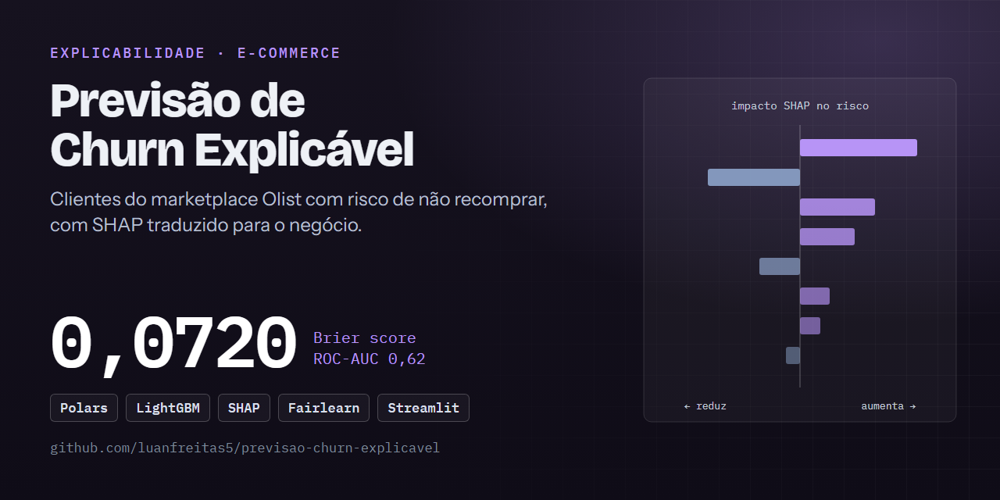
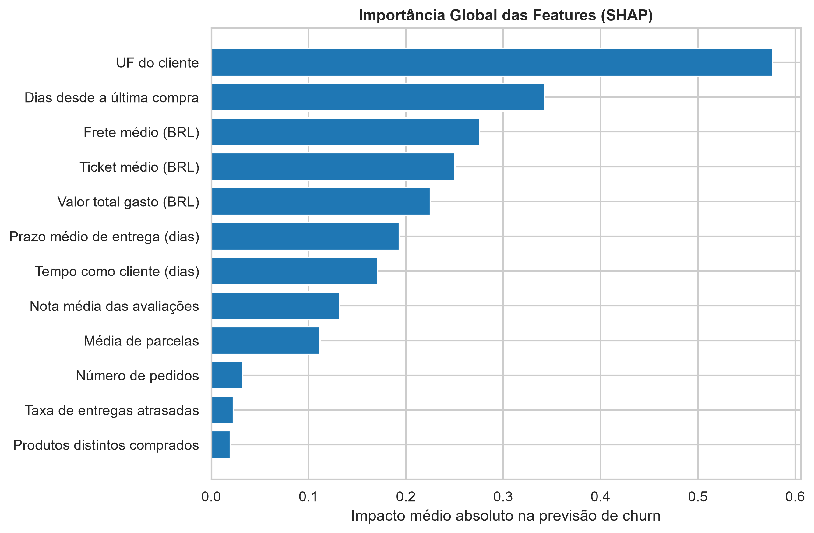
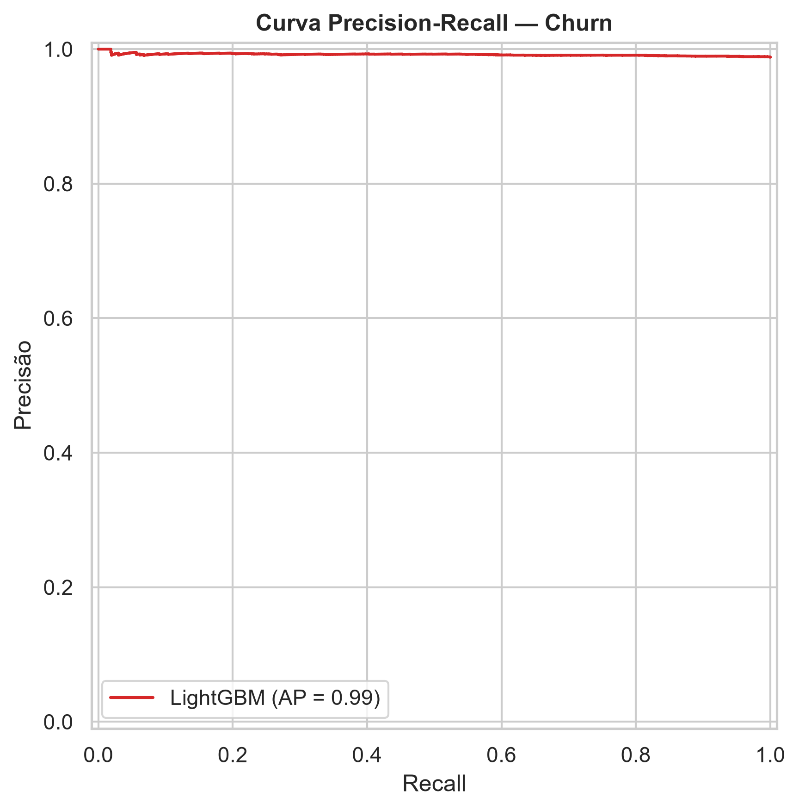

# 📉 Previsão de Churn Explicável: ranking de risco de não recompra com LightGBM + SHAP

[](https://github.com/luanfreitas5/previsao-churn-explicavel/actions/workflows/ci.yml)
[](https://codecov.io/gh/luanfreitas5/previsao-churn-explicavel)
[](https://luanfreitas5.github.io/previsao-churn-explicavel/)
[](LICENSE)
 <!-- = matriz do CI (tests.yml) -->

> **Resultado:** o LightGBM atinge PR-AUC (*average precision*) = **0,9919 (IC 95%: 0,9897–0,9939)** no teste, contra **0,9882** do baseline `DummyClassifier` (média em CV), em 11.272 clientes da Olist — mas a prevalência de churn é 98,8%, então a PR-AUC quase não sai do piso do baseline e a **ROC-AUC é de apenas 0,62**. O modelo serve para **ranquear** clientes para retenção, não para estimar probabilidades absolutas.



## 🎯 Problema

- **Quem decide o quê:** o time de retenção escolhe quais clientes contatar primeiro em campanhas de recompra; cada previsão vem com os fatores que a explicam (SHAP) em linguagem de negócio.
- **Custo dos erros:** falso negativo = cliente em risco que não recebe ação; falso positivo = desconto/contato desperdiçado. Como o interesse é a **ordenação** do risco, a métrica principal é a PR-AUC, lida junto com a ROC-AUC e o baseline (a PR-AUC sozinha é enganosa com 98,8% de positivos).
- **Unidade de predição e momento `t0`:** um cliente (`customer_unique_id`) no snapshot `t0 = 2018-03-01`; todas as features usam apenas pedidos ≤ `t0`. `churn = 1` se não houver pedido em `(t0, t0 + 180 dias]` (parametrizável em [`configs/config.yaml`](configs/config.yaml)).

## 🗂️ Dados

| Item | Valor |
|---|---|
| Fonte e licença | [Brazilian E-Commerce Public Dataset by Olist (Kaggle)](https://www.kaggle.com/datasets/olistbr/brazilian-ecommerce) — CC BY-NC-SA 4.0 (uso não comercial) |
| Tamanho / período | ~100 mil pedidos, 2016-09 a 2018-10; teste com 11.272 clientes (20%) |
| Alvo e prevalência | churn (não recompra em 180 dias), 98,82% positivos no teste |
| Documentação | [Datasheet](reports/datasheets/olist.md) |

Arquitetura medalhão em `data/` (fora do Git):

| Camada | Pasta | Conteúdo |
|---|---|---|
| 🥉 bronze | `data/bronze/` | CSVs da Olist exatamente como recebidos (imutáveis) |
| 🥈 silver | `data/silver/` | tabelas usadas, em parquet, com datas tipadas |
| 🥇 gold | `data/gold/` | base de features RFM + alvo, validada por contrato `pandera`, e divisão treino/teste |

## 📊 Resultados

Protocolo: divisão aleatória estratificada 80/20, `seed = 42`; CV estratificada de 5 folds no treino; IC do teste por **bootstrap (1000 reamostragens)** e IC do CV por 1,96·σ/√folds.

| Modelo | PR-AUC (IC 95%) | ROC-AUC | F1 / recall (limiar 0,5) |
|---|---|---|---|
| Baseline: DummyClassifier (prior), CV no treino | 0,9882 | 0,5 (por construção) | — |
| LightGBM, CV no treino (5 folds) | 0,9902 ± 0,0009 | — | — |
| **LightGBM, teste** | **0,9919 (0,9897–0,9939)** | 0,6214 | 0,966 / 0,944 |

- **Diferença vs baseline:** +0,0020 de PR-AUC no CV, da ordem do próprio IC do modelo. *Nenhum teste de significância foi executado ainda* — não é correto afirmar que o modelo é "melhor" sem ele (pendência registrada no [Model Card](reports/model_cards/churn_lightgbm.md)). O baseline também não foi medido no conjunto de teste.
- **Calibração:** Brier = 0,0720; com `class_weight="balanced"` e prevalência de ~99% as probabilidades não são calibradas.
- **Pior segmento (recall por UF):** TO = 0,865, AM = 0,882, GO = 0,916, contra SP = 0,928 e recall 1,000 em várias UFs pequenas (sem `n` por UF, a amplitude de 0,135 não é interpretável).
- **Explicabilidade (SHAP global):** UF do cliente (0,58), dias desde a última compra (0,34), frete médio (0,28) e ticket médio (0,25) lideram a importância.





Os números vêm de [`reports/metrics/metrics.json`](reports/metrics/metrics.json), [`reports/metrics/shap_global_importance.json`](reports/metrics/shap_global_importance.json) e de `models/churn_lightgbm_meta.json` (CV e hash dos dados). Outras figuras: [`reports/figures/`](reports/figures/).

## 🔁 Reproduzir

Requisitos: [uv](https://docs.astral.sh/uv/), `make` e o dataset da Olist baixado manualmente do Kaggle (extraia os CSVs em `data/bronze/`). Não há credenciais obrigatórias (ver `.env.example`). Tempo: `TODO(Luan)`: medir em uma máquina limpa.

```bash
git clone https://github.com/luanfreitas5/previsao-churn-explicavel.git
cd previsao-churn-explicavel
```

<!-- verify:start -->
```bash
uv sync --locked --all-groups --extra app
make pipeline   # features (bronze -> silver -> gold) -> train -> evaluate -> explain
```
<!-- verify:end -->

Saída esperada: `average_precision` no teste ≈ 0,9919 (IC 95%: 0,9897–0,9939) em `reports/metrics/metrics.json`. Ambiente que gerou os números publicados: `TODO(Luan)`: registrar a versão do Python e o commit do `uv.lock`. O `train` recusa árvore Git suja (`mlflow.require_clean_tree` em `configs/config.yaml`) para que cada run do MLflow carregue `git_sha`, `data_hash` e `seed`.

Outros alvos úteis:

```bash
make app        # dashboard Streamlit de explicabilidade
make check      # lint + tipos + segurança + qualidade + testes (espelha o CI)
make docker-up  # dashboard + MLflow em containers (modelo e data/gold montados do host)
```

## 🧱 Estrutura

```
configs/      YAML validados com Pydantic (config, paths, logging, model_params, deploy)
data/         bronze / silver / gold (fora do Git)
src/          config, data, features (RFM + churn), schemas (pandera), models,
              training, evaluation, explainability (SHAP), experiment (MLflow), pipelines
app/          dashboard Streamlit
reports/      metrics/ (JSON), figures/, model_cards/, datasheets/
docker/       Dockerfile do servidor MLflow (o do dashboard está na raiz)
tests/        unitários, property-based e comportamentais
```

## ⚠️ Limitações

- **Prevalência de ~99%:** quase todo cliente da Olist compra uma única vez; a PR-AUC é inflada pela prevalência e a ROC-AUC (0,62) mostra poder discriminativo modesto.
- **Sem significância nem baseline no teste:** a vantagem sobre o baseline é pequena e não foi testada estatisticamente.
- **Avaliação interna apenas:** divisão aleatória de um único snapshot (`2018-03-01`); sem validação temporal ou externa. Dados de 2016–2018 podem não refletir o comportamento atual.
- **Justiça por UF incompleta:** UF é feature e atributo sensível; faltam `n` e IC por UF e métricas de paridade (`fairlearn`).
- **Limiar de decisão** padrão de 0,5, não otimizado pelo custo de FP vs FN.
- **Linhagem:** o modelo atual foi treinado antes das tags `git_sha`/`data_hash` no MLflow; retreine com `make train` para gerá-las.

## 📄 Licença e citação

MIT — ver [LICENSE](LICENSE). Os dados de origem seguem a licença CC BY-NC-SA 4.0 do dataset. Documentação completa (MkDocs Material + mkdocstrings): `make docs-serve`.
